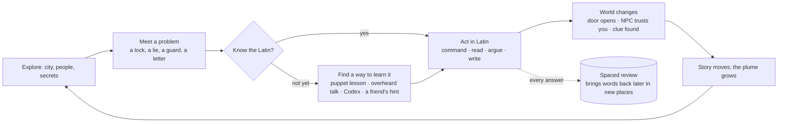
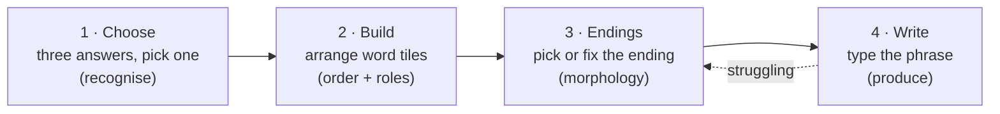
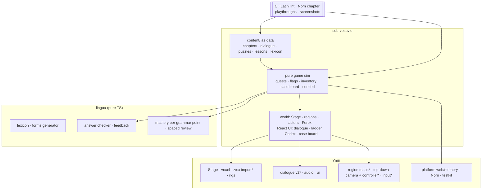
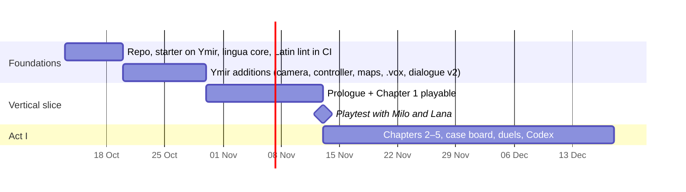
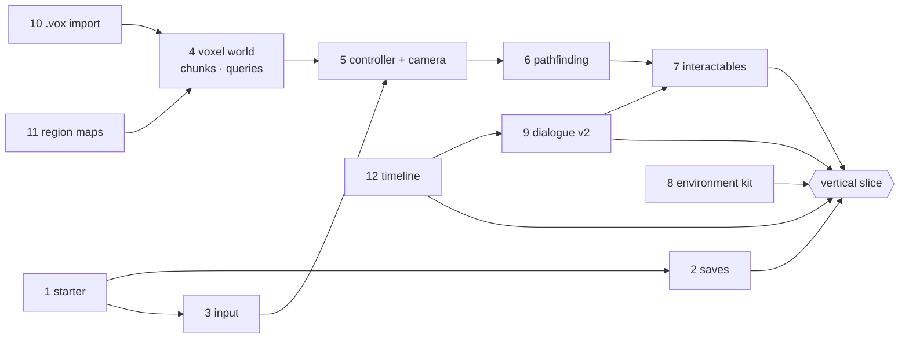
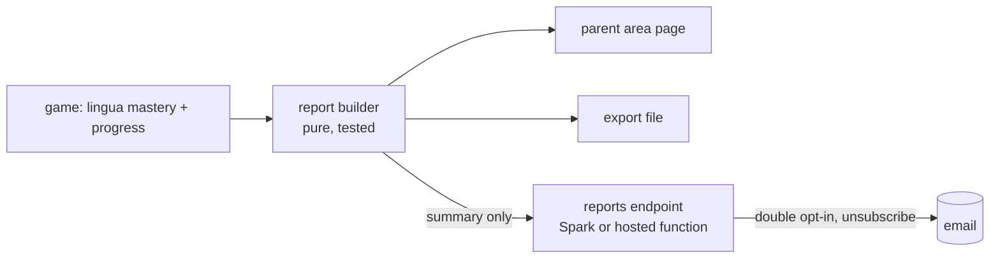

# Sub Vesuvio — design

*A Roman RPG where Latin is the hero's power.*

A top-down, three-quarter voxel RPG set in Pompeii in the autumn of AD 79. The hero is a 12-year-old newcomer
from Gaul who arrives knowing almost no Latin, and learns it the way the player does: from signs,
graffiti, market chatter, a dog that only obeys Latin commands, and people who will only trust you once you
can talk to them. The mountain is waking up. Someone in town knows, and is using it.

For any kid learning Latin, at their own speed. Built for Milo and Lana first.

---

## 1. What the game must be

| It is | It is not |
|---|---|
| An RPG you want to keep playing because of the story, the world and the mystery | A quiz with a map around it |
| Latin as the hero's toolkit: words open doors, win arguments, command a dog, decode letters | Latin as a toll booth before the fun |
| One story; the Latin adapts to each player | Separate "easy" and "hard" games |
| Accurate Latin, checked by the game itself on every build | Plausible-looking Latin, or Latin waiting on a human sign-off |
| Calm about Latin (no timers on any Latin answer) and exciting about everything else | Calm about everything |

**The test of success:** a kid asks to keep playing, and can read a real Pompeian graffito by the end of
Act I without being told it was a lesson.

### Lessons from Roma (what to keep, what to change)

Roma (`Radek44/latin-practice`) got the learning right and the game wrong. Keep its learning rules:

- Teach before testing.
- No timers or forced advances on Latin.
- Explain a wrong answer, then offer a retry.
- Jokes never at the learner's expense.
- Answers are checked by rules, not by a model.
- No children's data leaves the device.
- Human Classical Latin recordings over synthetic ones.
- Macron-tolerant input.

Change the frame. In Roma, learning is the activity and the world decorates it. Here the world, the
story and the play are the activity, and Latin is how you act in them.

---

## 2. The pitch

**Prologue: Porta Marina, October AD 79.** A ship from Massilia drops the hero at Pompeii's sea gate with
a letter for an uncle who has disappeared. The letter is in Latin. The hero can read one word of it.

**The hook.** The uncle was a water engineer on the Aqua Augusta, the aqueduct that feeds Pompeii.
Fountains are failing and the ground keeps trembling. A charming candidate for aedile is buying up houses
cheaply and promising water to anyone who votes for him. The uncle's last wax tablets are scattered across
the city, written partly in code.

**The pull.** Vesuvius sits on the horizon of every screen. Its plume grows a little each chapter. The
player always knows roughly how much time the city has. The town doesn't.

**The ending.** The hero uncovers the plot, persuades enough people to leave, and reaches Misenum and
Pliny the Elder's fleet for the rescue. Act III is a rescue story, not a disaster story: the player saves
people, and the final chapter is co-writing the letter that tells what happened.

**Why Pompeii:**
- Its real inscriptions are beginner-sized authentic Latin: *CAVE CANEM*, *SALVE LVCRV* ("welcome, profit"), election posters, shop signs, schoolboy graffiti.
- It has a built-in clock.
- A banker's surviving wax tablets make counting a plot point.
- A charcoal inscription found in 2018 (*XVI K NOV*) supports an October date for the eruption, which turns the Roman calendar into a puzzle.

Every real text needs checking against a published source before it ships. The alternative setting, if
you'd rather have Rome, is a fictional senatorial conspiracy built on Cicero's year (63 BC) and its
intercepted letters. Pompeii is the stronger choice for beginners.

### Cast

| Character | Role | Latin it carries |
|---|---|---|
| **The hero** (named by the player) | 12, from Gaul; learns Latin with the player. French is their home language, an in-story reason for French hints. | Everything |
| **Ferox** | A large, scruffy guard dog who adopts the hero (the *Cave canem* dog). Obeys only Latin commands. | Imperatives: *Venī! Sedē! Quaere! Ī!* |
| **Tullia** | Sharp, funny daughter of a banker; keeps the ledgers; becomes the hero's partner in the mystery. | Numbers, money, genitive (whose debt?), dates |
| **Gnaeus Popidius Celer** | The candidate for aedile. Warm, generous, lying. | Persuasive speech, then the past tenses of his lies |
| **Old Euplia** | Retired actor; runs a puppet theatre that is secretly the best grammar school in town. | The lesson scenes (§5) |
| **The Sibyl's letters** | Anonymous warnings left for the hero, in better and better Latin. | Future tense (prophecy); the long mystery |
| **Pliny the Elder** | Admiral and naturalist at Misenum; Act III. | Passive voice, reports, full sentences |
| **Cameos from Roma** | Senator Crumbulus, on official inspection of Pompeii's bakeries; Livia, an engineer called in about the aqueduct. | Comic relief, an inventor's lesson |

Slavery, debt and the eruption are part of this setting. Handle them honestly and at an age-appropriate
level: no graphic death, people with names and choices, rescue over catastrophe.

---

## 3. Latin is the hero's power

The design idea that makes this an RPG and not a quiz: **each piece of grammar is an ability**. It opens
new places, new conversations and new solutions, the way a hookshot does in Zelda.

| The player learns | …and can now |
|---|---|
| Imperatives | Command Ferox: fetch keys, dig, distract guards, find scents. |
| Nominative vs accusative | Read who did what to whom: "the dog bites the man" vs "the man bites the dog". Signs and orders stop being ambiguous. |
| Numbers I–M | Open numeral locks, check the banker's ledgers, haggle, pay the right toll. |
| Genitive | Read ownership: whose house, whose seal, whose debt. The core of the detective work. |
| Dative / ablative and prepositions | Follow directions, the uncle's coded routes, "with whom", "by what means". |
| Adjective agreement | Spot forged letters: the forger's endings don't agree. |
| Past tenses (imperfect, perfect) | Take testimony and catch contradictions in "what happened". |
| Future tense | Understand the Sibyl's warnings and plan the escape. |
| Passive voice | Read official reports and Pliny's orders; write the final letter. |

Grammar opens areas, Metroidvania-style. A gate the player can't pass yet always comes with a way to learn
what it needs nearby. **Progress is never hard-locked.** A player who is stuck gets help in a form that
still feels like play: Ferox sniffs out a clue, Tullia offers a hint, a lesson scene is offered. The
answer step can also drop one level (§4). A player is slowed, never stopped.

### The core loop



### Gameplay pillars

1. **Exploration.** A compact, dense Pompeii you can learn by heart: forum, baths, theatre, bakeries,
   fulleries, houses with mosaics, the amphitheatre, the necropolis outside the walls. Secrets
   everywhere, many behind Latin you can't read *yet*.
2. **Detective work.** Collect clues: tablets, seals, graffiti, testimony. A case board connects them.
   Most clues are Latin texts that become readable as the player grows.
3. **Verbal duels.** Forum debates in the spirit of Monkey Island's insult sword-fighting: hear
   opponents' lines around town, collect the right retorts, and win arguments with grammatically correct
   replies. No timer; tension comes from the crowd and the stakes.
4. **Light action.** Sling and staff against stray dogs, thieves in the sewers, and rats in the granary,
   with Ferox fighting beside the hero. Action never needs Latin. **Latin moments always pause the world.**
5. **Puzzles** (§6). Every chapter's signature puzzles need that chapter's grammar.
6. **Collecting.** The Codex (every word met, with recordings), graffiti rubbings (real texts), coins,
   Ferox's tricks, the uncle's tablets, and costumes for the hero.

---

## 4. Answering in Latin: the answer ladder

Every Latin interaction has four forms. The game picks one per player and per grammar point, from that
player's mastery. **Same story, same scene; Milo and Lana see different steps.**



- A player starts each grammar point at step 1 and moves up as their answers show mastery. Help, or a
  first answer that was wrong, moves them back down.
- Step 4 is checked by the `lingua` answer checker (§8). Any correct word order is accepted, macrons are
  optional, and *i/j* and *u/v* are interchangeable. Feedback names the actual error: "*rosa* is what the
  girl carries, so it takes the accusative: *rosam*."
- Glosses (word meanings on hover or tap) thin out as words are mastered. French hints are a per-player
  setting, alongside other hint languages later.
- Optional challenge scrolls let a fast learner (Lana) push ahead: harder versions of side quests, more
  graffiti, longer texts. Nothing in the main story is gated on them.

---

## 5. Lessons: the puppet theatre

You asked for generated videos that teach a concept. The recommendation is **lesson scenes played in the
game engine**, not AI-generated video. Video models still render text unreliably, and Latin grammar
lives in the endings. A garbled *-ārum* teaches the wrong thing, and it can't be fixed in an editor.

**Old Euplia's puppet theatre** (*Theatrum Grammaticum*):
- Each lesson is a 60–120 second scene: voxel puppets, a painted backdrop, the ending table built live on
  stage, and recorded narration in English, with French and other languages as packs. The Latin is spoken
  by human recordings.
- Grammar is acted out. Swap one ending and *canis virum mordet* turns into *canem vir mordet*, and the
  puppets swap roles, to the crowd's horror.
- Lessons are scripted in the same dialogue system as the game, so they are as testable as everything
  else and cheap to change.
- They are found in the world (Euplia's theatre, a scroll in the uncle's study) right where the puzzle
  that needs them is. Once seen, they can be replayed from the Codex.
- Each one ends by handing the player the thing they need: "Go and tell that guard *what* you want."

AI-generated video still has a place: **text-free story cinematics** (the plume rising, the fleet
sailing), rendered in the voxel art style, possibly on Spark. Every one is reviewed before use.

---

## 6. Puzzles

Each puzzle is a pure function: seed → instance → check. It is generated in variants, so a replay isn't
rote, and Norn can solve it in CI.

| Puzzle | Grammar | Example |
|---|---|---|
| **Numeral locks** | Roman numerals, cardinals | The banker's strongbox wants the total of three debts, entered as numerals. |
| **Ending doors** | Case endings | An inscription missing its endings: `PORTA AQV__ APERITVR`. Fit the ending tiles. |
| **Mosaic sentences** | Word roles, agreement | Rotate mosaic tiles until the sentence says what the picture shows. |
| **Ledger audits** | Numbers, genitive | Find whose account doesn't add up. |
| **Forged letters** | Agreement, tenses | Mark the errors; the forger's habits identify them. |
| **Calendar locks** | Kalends, Nones, Ides; ordinals | "Meet me *ante diem III Nonas*": which day is that? |
| **Testimony** | Past tenses | Two witnesses, one contradiction. |
| **Ferox trails** | Imperatives, directions | Guide Ferox through a sewer with commands. |
| **Election posters** | Imperatives, accusative | Fix a programma so it actually asks people to vote for your candidate. |

---

## 7. Chapters and the grammar they carry

The default order is a standard beginner sequence. Optional **syllabus maps** line the chapters up with
the textbook a kid's class uses: *Familia Romana*, the Cambridge Latin Course (also set in Pompeii),
*Ecce Romani*, *Wheelock* and others. A parent page can then say "this matches your Chapter IX". The
game is never paced by the class; the player goes as far as they want.

| Act | Chapter | Story | Grammar |
|---|---|---|---|
| I · *Pompeii* | Prologue · *Porta Marina* | Arrival, the uncle's letter, meeting Ferox | *sum/est*, greetings, nominative, numbers 1–10 |
| | 1 · *Forum* | Finding the uncle's office; the election | 1st declension nom/acc; present tense (3rd person) |
| | 2 · *Cave Canem* | Ferox's tricks; the first break-in | 2nd declension; imperatives |
| | 3 · *Tabulae* | Tullia and the ledgers; the first coded tablet | Numbers to M; genitive |
| | 4 · *Thermae* | Gossip at the baths; the aqueduct's secret | Dative and ablative; prepositions |
| | 5 · *Theatrum* | Euplia's past; the candidate's speech | 3rd declension; all persons of the present |
| II · *The plot* | 6 · *Terra Movetur* | Tremors; testimony; who was where | Imperfect and perfect |
| | 7 · *Herculaneum* | The library villa; the Sibyl's identity | Adjectives and agreement; relative pronouns |
| | 8 · *Nonae* | Calendar codes; the trap | Dates, ordinals; future tense |
| III · *Escape* | 9 · *Mons* | Convincing the town to leave | Persuasion: everything so far, in sentences |
| | 10 · *Misenum* | Pliny's fleet; the rescue | Passive voice; reports |
| | Epilogue · *Epistula* | Writing what happened | Free composition, checked by `lingua` |

Act I is the first full build target. Acts II and III follow if the kids want more, which they should.

---

## 8. Technology

**Web, on Ymir.** The Latin engine is the heart of the game, it is TypeScript, and it is testable
headless. Roma's learning code (normalisation, spaced review, the audio registry) is also TypeScript.
Ymir already provides `Stage`, voxel models and rigs, dialogue, audio, the platform targets, UI, Norn and
CI. Godot can't run the TypeScript engine; it would mean porting it to GDScript and leaving Roma's
content behind.

**Players:** a browser on a laptop or tablet. It deploys as a static site, so any kid can play with no
account, with saves stored locally. For Milo and Lana, it can optionally sync to the Roma household
server on Spark.


`*` = new in Ymir. This game is the second user for each.

### `lingua`: the Latin engine

- **Lexicon:** each entry has a lemma, principal parts, a declension or conjugation class, gender,
  meanings, a frequency rank and audio. The starting set is roughly the 1,000 most common words, drawn
  from openly licensed lists. Check each licence: the Dickinson College Commentaries core vocabulary is
  CC BY-SA, Whitaker's Words is freely distributed, and Wiktionary is CC BY-SA. Every generated paradigm is
  checked automatically against an independent reference table (§8, *Latin is checked on every build*).
- **Forms generator:** every form of every word, with irregulars listed explicitly.
- **Analyser:** takes a form and returns every possible reading. *-ae* has four; the game never
  pretends otherwise.
- **Answer checker:** an answer is a frame, not a string: subject *puella* (nominative singular), object
  *rosa* (accusative singular), verb *portāre* (3rd person singular present). A typed sentence is
  tokenised, normalised and analysed, then matched to the frame in any word order. The result is either
  correct or the specific error, which drives the feedback.
- **Mastery:** per grammar point and per word. It decides the answer-ladder step and the gloss density.
  It extends Roma's 1/3/7/14/30/60-day review.

### Latin is checked on every build

A CI job enforces the following:
- Every Latin line in the content parses with `lingua`.
- Every word appears in the lexicon.
- Every line's tagged grammar points match its actual forms.
- Every puzzle variant is solvable.
- Every intended answer is accepted, and every listed wrong answer is rejected with the right feedback.

Norn plays each chapter from a save to the end, headless. Wrong Latin breaks the build before a kid ever
sees it.

No human sign-off gates a release. On top of the content checks, the game verifies the Latin engine
itself against independent data:
- **Paradigms:** every form `lingua` generates is compared with an independent inflection table (for
  example, one derived from Wiktionary). Any disagreement fails the build and is listed by word.
- **Reading direction:** every sentence the content uses is analysed back by `lingua`. Its readings must
  include the intended one, or the line is ambiguous in a way the author didn't mean.
- **Answer checker:** a fixed suite of known right and wrong answers (word orders, missing macrons, wrong
  case, wrong number) must keep passing.

Teachers and parents still see everything, through the progress reports (§14), and can flag a line. A
flag becomes a test case, so it can't come back.

### Ymir additions this game needs

See §13 for the Ymir roadmap: what to add, which existing games also use it, rough APIs, and the build
order.

### From Roma

- **Adopt:**
  - answer normalisation;
  - the spaced-review scheduler;
  - the Latin audio registry and its human Classical recordings with their credits;
  - the declension reference content;
  - the font choices (Noto Serif renders macrons correctly);
  - the learning rules in §1.
- **Optional later:** household accounts and sync on Spark.
- **Leave:** the quiz-screen structure.

---

## 9. Art direction

- **The view:** three-quarter top-down, Zelda-style, with a slight tilt-shift so the town reads as a
  living diorama.
- **Voxels:** high detail, with characters about 24–32 voxels tall (Ymir's humanoid builds at double
  density). Buildings are made in MagicaVoxel. The palette is Pompeian: ochre, Pompeian red, umber,
  lime-white plaster, terracotta, olive, sea blue. Mosaics and frescoes are drawn into the voxels.
- **Vesuvius** is always on the horizon, and its plume is chapter state.
- **Portraits** come from the same rigs (`renderPortraits`), so dialogue faces always match the world.
- **Audio:** an ambient town that changes by district, a small score, and Latin spoken only by human
  recordings or reviewed voices. Roma's rule applies: a pleasant voice is not evidence of correct
  pronunciation.

---

## 10. Milestones



**The vertical slice** is the first thing worth judging:
- Porta Marina and the Forum.
- The hero, Ferox (three commands) and Tullia.
- One puppet lesson.
- Three puzzle types: a numeral lock, an ending door, an election poster.
- One verbal duel.
- All four answer steps for the first declension.

It is judged by one question: *do they ask to play again tomorrow?*

## 11. Risks

| Risk | Mitigation |
|---|---|
| Writing graded Latin dialogue is the real cost | Content as data; Claude drafts within a lexicon and grammar budget per chapter; `lingua` lint |
| Wrong Latin reaches kids | The CI lint, paradigm cross-checks and Norn playthroughs (§8); teacher flags in reports become tests |
| Fun and learning pull apart | Grammar as abilities; playtests from the slice on; watch where kids skip, not just whether they're correct |
| RPG scope | One act at a time; the slice before anything else |
| Typing on tablets | On-screen keyboard; steps 1–3 need no typing |
| Historical and sensitive content | A short sensitivity pass per act; sources noted for every real text |

## 12. Open decisions

Decided:
- **Pompeii**, as pitched.
- **Latin is checked by the game**, with no human gate (§8).
- **Progress reports** go to a parent or teacher email (§14).
- **Brand-new repo**, `Radek44/sub-vesuvio`; Roma's learning code is adopted where useful.
- **Title:** *Sub Vesuvio*.

Still open:
1. Pronunciation: Classical (Roma's choice, recommended), with Ecclesiastical as an option for schools that use it.

---

## 13. Ymir roadmap

Ymir's rule is to extract only what two games already do. For each feature below, the table names the
other users. Where this game is the only user so far, the feature is built in the game first, shaped to
move into Ymir later. Ymir must never know about Latin: everything below is generic, and `lingua` stays in
the game.

### What exists and what's missing

| Need | Ymir today | Gap |
|---|---|---|
| A whole town in voxels | `VoxelGrid` + `meshVoxels`: one grid, coordinates packed in 8 bits (−128…127 per axis), meshed whole | No chunks, so no world bigger than 256 voxels a side and no partial re-mesh. No collision queries. |
| Hand-built voxel art | Models painted in code (`box`, `rect`, `eyes`) | No MagicaVoxel import |
| Walking around a world | `fitArena` (a fixed arena camera), `KeyStick`, `Joystick` | No follow camera, character controller, collision, or unified input |
| Conversations with state | `Script` (lines, choices, gotos, `{vars}`), incidents with `when` | No conditions or effects on lines and options; no "wait for an answer" beat; no portraits or glosses |
| Things to talk to and use | `Stage.toScreen` | No proximity interaction or prompts, no DOM anchors that follow actors |
| Saves that survive updates | `loadSave`/`writeSave`, slots | No schema versions or migrations |
| Lighting and mood | GG `setVenue`, FM `environment.ts` (both still in the games) | No shared environment kit |
| Cutscenes and lessons | FM's cue bus, `Stage` | No timeline for camera, actors and lines together |

### The features, in build order

| # | Feature | Where | Also used by | Size |
|---|---|---|---|---|
| 1 | **Game starter** `templates/game` | Ymir | Every new game | M |
| 2 | **Save schema and migrations** | Ymir `ymir/platform` | MHR (`migratePeople`), FM (slot mapping), Roma (profile migration) | S |
| 3 | **Input actions** | Ymir `ymir/ui` | GG (`KeyStick` + `Joystick`), Roma (WASD), FM (orbit, tap) | S |
| 4 | **Voxel world: chunks, meshing, queries** | Ymir `ymir/voxel` + `ymir/three` | FM island terrain, Roma island terrain | L |
| 5 | **Character controller and follow camera** | Ymir `ymir/three` | GG (the player on the floor), Roma (walking the island) | M |
| 6 | **Grid pathfinding** | Ymir `ymir/core` | Roma (`findWorldPath`), MHR (`deskPath`) | S |
| 7 | **Interactables and anchors** | Ymir `ymir/three` | MHR (`bindAnchor`), FM (`screenOf`), GG (`project`) | S |
| 8 | **Environment kit** | Ymir `ymir/three` | GG venues, FM island environment | M |
| 9 | **Dialogue v2: graph, conditions, effects, prompt beats** | Ymir `ymir/dialogue` | FM tour and events, MHR coach and tickets | M |
| 10 | **MagicaVoxel `.vox` import** | Game first, then Ymir | (none yet) | S |
| 11 | **Region maps** | Game first, then Ymir (`ymir/map`) | Roma destinations; a future tile game | M |
| 12 | **Cutscene timeline** | Game first, then Ymir | FM cues, Roma's bridge camera | M |
| 13 | **Quest and flag state** | Game | MHR goal chain and FM directives are dailies, not story quests | M |
| 14 | **Spaced review and mastery** | Game (`lingua`) | Roma; `matma` if it's a learning game too | S |



### API sketches

These are shapes for review, not final names.

**4 · Voxel world.** The world is split into 32³ chunks. Each chunk is meshed and drawn on its own,
re-meshed only when edited, and faces between chunks are culled across the border. `VoxelGrid` and
`meshVoxels` stay as they are for single models.

```ts
const world = new VoxelWorld({ chunk: 32 });           // pure: ymir/voxel
world.stamp(model, { x, y, z, rotate: 1 });            // place a .vox or code-painted model
world.solidAt(x, y, z); world.groundAt(x, z);          // queries for collision and placement
world.raycast(from, dir, max);                         // picking, line of sight
const view = new WorldView(stage.scene, world);        // ymir/three: one mesh per chunk, frustum-culled
view.sync();                                           // re-mesh only dirty chunks
```

**5 · Controller and camera.** A kinematic capsule against `VoxelWorld`. It steps up voxels below a set
height, slides along walls and never tunnels at low frame rates. The camera follows at a fixed
three-quarter angle with a soft dead-zone, and can switch to a scripted shot.

```ts
const hero = new Mover(world, { radius: 0.3, height: 1.6, step: 0.5, speed: 4 });
hero.move(input.vector(), dt);                         // returns the collisions it hit
const cam = new FollowCamera(stage.camera, { pitch: 0.95, distance: 14, deadZone: 1.5 });
cam.follow(hero.position, dt); cam.frame(points, 0.6); // cutscenes: frame a group, ease back
```

**3 · Input.** One action map for keyboard, gamepad and touch, so games stop writing their own.

```ts
const input = createInput({ move: 'stick', interact: ['KeyE', 'Space', 'pad:A', 'tap'], codex: ['KeyC', 'pad:Y'] });
input.vector(); input.pressed('interact'); input.device(); // 'keys' | 'pad' | 'touch', for button hints
```

**9 · Dialogue v2.** An extension of `Script`, so existing scripts still run:
- `when` on nodes and options, and `effects` the game applies in its reducer (the same pattern as
  incidents);
- a portrait key per speaker;
- an annotations field, which this game uses for glosses and grammar tags;
- a **prompt beat**: the script stops and waits for an answer, checked by a function the game supplies.

Ymir runs the conversation; the game decides what a correct answer is.

```ts
type Beat = /* line | choice | end | */ { kind: 'prompt'; id: string; prompt: string; data: unknown };
advance(script, cursor, { answer, check: (id, answer) => game.check(id, answer) }); // → next node by result
```

**2 · Saves.** Versioned saves with ordered migrations, run once on load and covered by a test of every
migration from every past version.

```ts
const saves = defineSave({ version: 3, initial, migrate: { 2: (s) => ({ ...s, ferox: { tricks: [] } }), 3: addCaseBoard } });
```

**7 · Interactables.** Anything with a position, a radius and a verb. The nearest one in reach shows a
prompt ("*Speak*", "*Read*", "*Command Ferox*") placed with `toScreen`. DOM anchors follow actors, which is
MHR's `bindAnchor`, generalised.

**8 · Environment kit.** Sky gradient, sun and ambient light, fog and time of day as one state object
that blends over time. GG's venues and FM's themes become presets. This game's plume is a preset
parameter.

### What stays in the game, and why

- **`lingua`**, the Latin engine. No other game needs it. If a second language game ever arrives, it
  becomes its own package, not part of Ymir.
- **Quests, the case board and story flags.** These only become generic once a second story game exists.
- **Content:** chapters, puzzles, lessons and art.

### Order of work

1. **Ymir 0.8:** features 1–3. The starter, saves and input are small, and every game benefits at once.
   Then start this game's repo from the starter.
2. **Ymir 0.9:** features 4–7, built against Porta Marina as the test level. This is the largest step.
3. **Ymir 0.10:** features 8–9. Then the vertical slice.
4. **After the slice:** promote 10–12 into Ymir if they've held up. Move Graveyard Groove onto `Stage`,
   input and the environment kit, as each one's second user.

---

## 14. Progress reports for parents and teachers

A parent or teacher can add an email address per player, and the game sends them a progress report.
Reports are records, not surveillance: what was learned, not every keystroke.

**What a report contains (weekly by default, or after each chapter):**
- Time played, and the chapters and quests finished.
- Each grammar point and how far up the answer ladder it has reached (§4): *recognises*, *builds*,
  *fixes endings*, *writes*. This is the honest measure, better than a percentage.
- Words met and words mastered, with the ones due for review.
- What's hard right now: the grammar points with the most help or first-try misses, each with an example.
- A syllabus-map line when one is set: "matches Familia Romana, Chapter IX".
- A "flag a line" link for any Latin the adult disagrees with (§8).

Free-text answers are left out by default. A teacher can turn on "include written answers" per player
to see the step-4 sentences.

**How it's set up:**
- A **parent area** behind a PIN or a simple arithmetic gate, so kids don't change it.
- **Double opt-in.** The address must confirm before anything is sent. A public game must never be able
  to send mail to a stranger.
- **One-click unsubscribe** in every report.
- **Also a page:** the same report is shown in the parent area. For anyone who prefers no email, it can
  be exported as a file.

**How it's sent.** A static web page can't send email, so reports go through a small backend:
- **At home:** the Roma household server on Spark, which already holds accounts. It sends through a
  mail provider or SMTP, and the address and keys stay on the server.
- **For any kid:** the same endpoint as a small hosted function. The game posts a report summary,
  never raw events, and the function sends it.



**Later: classroom records.** The same records can be emitted as xAPI statements to a school's learning
record store, the standard many school systems read. That only matters once a teacher asks for it.

**Ymir's part.** `ymir/analytics` already sends events to any sink, which suits gameplay analytics. The
report is different: a learner summary built by the game. The report builder and the endpoint live in the
game, and the endpoint's client uses a sink-style interface so it can be swapped. If a second learning
game ever needs reports, they move to Ymir then.
